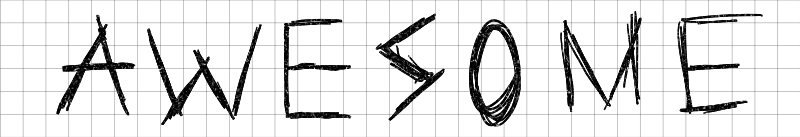

# Awesome reMarkable 

# [
](https://github.com/sindresorhus/awesome)

The [reMarkable](https://www.remarkable.com) is a paper tablet for those who prefer writing on paper. Its remarkably fast paper-white display, Linux based operating system and awesome community make it highly attractive amongst hackers and developers.

*Contributions are welcome as long as they follow the [guidelines](CONTRIBUTING.md).*

## Disclaimer

No project here is affiliated or endorsed by [reMarkable AS](https://github.com/remarkable). If you modify your device official support might refuse to help you.

### Write down your SSH password

**:warning: WARNING, READ THIS FIRST :warning:**

**Make sure you have saved your SSH password somewhere secure, or you have setup a [SSH key](https://remarkable.guide/guide/access/ssh.html#creating-a-ssh-key)**

You can find the SSH password in your settings: `Settings > Help > Copyrights and licenses > General information (scroll down)`.

Failure to do so could result in a **soft-bricked device** that requires [emergency recovery](https://remarkable.guide/tech/recovery.html).

### Factory reset may brick your device

This function may not do what you are expecting. While it resets all user data, it will not restore the device to the original factory condition. It will reset your SSH password and remove all SSH keys, which may make it impossible to connect to your device if it is malfunctioning.

See [remarkable.guide](https://remarkable.guide/tech/factory-reset.html) for more information on how to properly factory reset your device.

### Take special care if you are using a reMarkable 2.

- System recovery requires some hardware. See https://remarkable.guide/tech/recovery.html#remarkable-2-recovery for more information.
- The screen on rm2 and rm1 are different. Workarounds have been developed to interact with the rM2 framebuffer but some projects might not work on it. See [ddvk/remarkable2-framebuffer](https://github.com/ddvk/remarkable2-framebuffer) and [ddvk/remarkable2-framebuffer#14](https://github.com/ddvk/remarkable2-framebuffer/issues/14).

## Contents

- [APIs](#apis)
  - [Cloud API](#cloud-api)
  - [Lines Format](#lines-format)
  - [Other APIs](#other-apis)
- [Applications](#applications)
  - [Games](#games)
  - [Launchers](#launchers)
- [Cloud Tools](#cloud-tools)
- [Custom Templates](#custom-templates)
- [Device Tools](#device-tools)
- [GUI Clients](#gui-clients)
- [Interface Customization](#interface-customization)
- [Other](#other)
- [Screen Sharing/Streaming](#screen-sharingstreaming)

## APIs

### Cloud API

- (Unmaintained) [google-drive-remarkable-sync](https://github.com/bsdz/google-drive-remarkable-sync) - Apps Script API for reMarkable Cloud. Includes Synchronizer capability to automate mirroring of documents from Google Drive to reMarkable Cloud.
     

- [jrmapi](https://github.com/jlarriba/jrmapi) - A Java API for the reMarkable Cloud.
     

- (Unmaintained) [reMarkableAPI](https://github.com/splitbrain/ReMarkableAPI) - Docs and implementation of the reMarkable file sync API.
     

- (Unmaintained) [reMarkable-typescript](https://github.com/Ogdentrod/reMarkable-typescript) - TypeScript API for reMarkable Cloud.
     

- [Remarkable.jl](https://github.com/theogf/Remarkable.jl) - Julia API Interface to the reMarkable cloud.
     

- [remarkdav](https://github.com/hansegucker/remarkdav) - A tool to sync PDF files from a WebDAV directory to the reMarkable Cloud.
     

- [rMAPI](https://github.com/ddvk/rmapi) ReMarkable Cloud Go API.
     

- (Unmaintained) [rmapy](https://github.com/subutux/rmapy) - ReMarkable Cloud Python API.
     

- [rmcl](https://github.com/rschroll/rmcl)- Asynchronous Python library for the reMarkable Cloud.
     

- [rmfakecloud](https://github.com/ddvk/rmfakecloud) - Fake Cloud Sync, server implementation of the Cloud API.
     

### Lines Format

- [librm_lines](https://github.com/RedTTGMoss/librm_lines) - A C++ library for reading & writing & rendering v6 files with the original reMarkable quill library, includes multiple languages wrappers for python and npm.
     

- [lines-are-beautiful](https://github.com/ax3l/lines-are-beautiful) - C++ File API for the reMarkable tablet.
     

- [lines-are-rusty](https://github.com/ax3l/lines-are-rusty) - Rust File API for the reMarkable tablet.
     

- [reMarkable-kaitai](https://github.com/matomatical/reMarkable-kaitai) - [Kaitai Struct](https://kaitai.io/) format specification for the binary lines format.
     

- (Unmaintained) [reMarkable-layers](https://github.com/bsdz/remarkable-layers) - Python API for reading & writing reMarkable Lines format. Supports very basic conversion of PDFs and SVGs to Lines format.
     

- [rmrl](https://github.com/rschroll/rmrl) - The reMarkable Rendering Library for Python converts annotated documents to PDF files.
     

- [rmscene](https://github.com/ricklupton/rmscene) - Python library to read v6 files / software version 3.
     

### Other APIs

- [libreMarkable](https://github.com/canselcik/libremarkable) - A framework for developing applications with native refresh support for reMarkable Tablet.
     

## Applications

- [harmony](https://rmkit.dev/apps/harmony) - a low latency sketching app with procedural brushes.
- [KOReader](https://github.com/koreader/koreader) - An ebook reader application supporting PDF, DjVu, EPUB, FB2 and many more formats.
     

- [darvin/plato](https://github.com/darvin/plato) [LinusCDE/plato](https://github.com/LinusCDE/plato) - Plato reader port. Supports pdfs, epubs, many other formats.
     

- [Rebook](https://github.com/fsniper/ReBook) - The missing book store for reMarkable.
     

- [reGenda](https://github.com/tenJirka/reGenda) - An agenda-based calendar for reMarkable.
     

- [reMarkable keywriter](https://github.com/dps/remarkable-keywriter) - A distraction free keyboard notes app.
     

- [reMarkable SSH explorer](https://github.com/iacobucci/rm-ssh-explorer) - An on-device ssh explorer for downloading pdf files from a server to the reMarkable tablet
     

- [reMarkable wikipedia](https://github.com/dps/remarkable-wikipedia) - Offline wikipedia reader for reMarkable.
     

- (Unmaintained) [remarkaBot](https://github.com/Davide95/remarkaBot) - Fetch your documents from Telegram.
     

- [whiteboard-hypercard](https://github.com/fenollp/reMarkable-tools) - Live collaboration, drawing, chat, whiteboarding.
     

- [Writerdeck for reMarkable 1](https://github.com/bjornte/Writerdeck-for-reMarkable) - Distraction-free Markdown word processor with keyboard support via a companion app or usb. With optional syncing and encryption of documents.
     

### Browser extensions

- [rePub](https://github.com/hafaio/repub) - unofficial browser extension that creates ePubs from websites and can either upload them to reMarkable cloud or save them locally, currently for Chrome only
     

- [rePubfox](https://github.com/jrockwar/repubfox) - a hard fork of rePub for Firefox
     

### Games

- [chessMarkable](https://github.com/LinusCDE/chessmarkable) - Play chess against a bot or a friend.
     

- [DOOMarkable](https://github.com/LinusCDE/doomarkable) - Play DOOM on the reMarkable 1.
     

- [minesweeper](https://rmkit.dev/apps/minesweeper) - A mine detection game.
- [recrossable](https://github.com/sandsmark/recrossable) - Crossword game with simplistic handwriting recognition and automatic generation of crosswords.
     

- [retris](https://github.com/LinusCDE/retris) - Play a clone of the popular block stacking game with either buttons or swipe guestures.
     

### Launchers

- [draft-reMarkable](https://github.com/dixonary/draft-reMarkable) - A launcher for the reMarkable tablet, which wraps around the standard interface.
     

- [oxide](https://oxide.eeems.codes) - A launcher application for the reMarkable tablet.
- [remux](https://rmkit.dev/apps/remux) - A multi-tasking launcher for the reMarkable tablet.

## Cloud Tools

- [AgentNews-RemarkableRSSReader](https://github.com/eksubin/AgentNews-RemarkableRSSReader) - An AI agent for processing RSS news feeds and sending them to reMarkable via Google Drive API.
     

- [Aviary](https://github.com/rmitchellscott/aviary) - A webhook-driven document uploader for reMarkable Cloud and rmfakecloud, featuring a static UI and a Go backend. Optional integration for email via AWS SES.
     

- [CUPS Printing](https://github.com/ofosos/scratch/tree/master/remarkable-cups) - Script to print directly to reMarkable Cloud from CUPS using rMAPI.
     

- [mendeley-rMsync](https://github.com/anilkyelam/mendeley-rMsync) - Script to sync PDFs (with annotations) from/to a [Mendeley](https://www.mendeley.com/) folder.
     

- [Moss](https://github.com/RedTTGMoss/moss-desktop) - An app for working with your documents in the reMarkable/rmFakeCloud cloud
     

- [pdf2remarkable](https://github.com/teticio/pdf2remarkable) - Script to upload PDFs to the reMarkable Cloud.
     

- (Unmaintained) [reCatchable](https://github.com/lapwat/reCatchable) - Turn websites into ebooks, upload them to reMarkable.
     

- [reGitable](https://github.com/after-eight/regitable) - Backup your reMarkable with git and sync changes to a remote repository automatically.
     

- [Remarcal](https://remarcal.com/) - Sync Google, Outlook, Apple, and more calendars to reMarkable.
- [reMarkable Morning News_2](https://github.com/ktibr0/Remarkable_morning_news_2) - Automatically sends daily news to your reMarkable tablet. Standalone web application with persistent storage.
     

- [reMarkable RSS](https://github.com/eksubin/Remarkable-RSS-Feed) - Read RSS feeds on reMarkable via google drive integration. Automated Script to convert RSS-feeds as PDFs and upload to google drive.
     

- [remarkable-mcp](https://github.com/SamMorrowDrums/remarkable-mcp) - Model Context Protocol server enabling AI assistants to read and browse your reMarkable documents via SSH (no subscription required) or Cloud API. [Blog post](https://sam-morrow.com/blog/building-an-mcp-server-for-remarkable).
     

- [remarkable_simplenote](https://github.com/bgribble/remarkable_simplenote) - Sync simplenote notes to reMarkable (currently one-way)
     

- [reMarkable-Sink](http://github.com/hmenzagh/reMarkable-Sink) - Turn a folder into a wormhole to your reMarkable.
     

- [remarkable-substack](https://github.com/jwoglom/remarkable-substack/) - Syncs unread Substack posts to the reMarkable Cloud.
     

- [reMarkable_syncthing](http://github.com/evidlo/remarkable_syncthing) - Syncthing on reMarkable.
     

- [reMarkable Todoist and Calendar Sync](https://github.com/usuallycwdillon/remarkable-calendar) Puts Todoist tasks and Google calendar events on a calendar then pushes to reMarkable.
     

- [remarkable-zapier](https://github.com/artes-dev/remarkable-zapier) - Zapier Integration for reMarkable Cloud
     

- [remarking](https://github.com/sabidib/remarking) - CLI tool to extract highlights from any document in the reMarkable cloud.
     

- [rm-brain](https://github.com/gabrielanhaia/remarkable-brain) - Turns your reMarkable notebooks into a local-first, searchable second brain you query through Claude Desktop.
     

- [rm-pdf-tools](https://github.com/skius/rm-pdf-tools) - Service that allows users to insert and delete pages from annotated PDFs on the device.
     

- [rM-sync](https://github.com/simonschllng/rm-sync) - Sync script for reMarkable paper tablet.
     

- [RMfuse](https://github.com/rschroll/rmfuse) - FUSE filesystem for the reMarkable Cloud.
     

- [rss2remarkable](https://codeberg.org/akselmo/rss2remarkable) - Generates PDF of given RSS feeds and send is to your reMarkable cloud.
    

- [send-to-remarkable](https://github.com/zegevlier/send-to-remarkable) - Upload documents to the reMarkable from an email, like send to Kindle.
     

- [sync_zotero_remarkable](https://github.com/danijoo/sync_zotero_remarkable) - Sync PDFs from Zotero to reMarkable.
     

- [Syncthing-for-reMarkable-AppLoad](https://github.com/paviro/Syncthing-for-reMarkable) - Syncthing appload app for reMarkable (incl. Paper Pro and Paper Pro Move).
     

- [url2epub](https://github.com/fishy/url2epub) - Telegram bot to generate ePub out of URL and send directly to reMarkable Cloud.
     

- [zotero-reMarkable](https://github.com/michaelmior/zotero-remarkable) - Script to sync PDFs from the [Zotero](https://www.zotero.org/) reference manager.
     

- (Unmaintained) [Zotero2reMarkable Bridge](https://github.com/opal06/zotero2remarkable_bridge) - Sync files from Zotero to reMarkable and back based on tags; supports v2.7< highlights.
     

## Custom Templates

- [blank_slate_pdf](https://github.com/sowcow/blank_slate_pdf) - Flexible PDFs for nested lists or experiments with no predefined template, separate simple calendar, customization using ruby code.
     

- [latex-yearly-planner](https://github.com/kudrykv/latex-yearly-planner) - PDF planner designed for e-ink devices.
     

- (Unmaintained) [ReCalendar](https://github.com/klimeryk/recalendar) - Highly customizable calendar generator in PHP optimized for reMarkable.
     

- [reMarkable-bujo](https://github.com/vonneudeck/remarkable-bujo) - "Bullet Journal" templates.
     

- [remarkable-engineering](https://gitlab.com/asciipip/remarkable-engineering) - Engineering-style grid templates.
     

- [reMarkable-gtd-templates](https://github.com/BartKeulen/remarkable-gtd-templates) - "Getting Things Done" templates.
     

- [reMarkable_templates](https://github.com/steka/reMarkable_templates) - White lines/squares on gray background.
     

- [reMarkabletemplates](https://github.com/equivocates/remarkabletemplates/) - Planner per 1 or 3 weeks.
     

- [rM2Mods templates](https://github.com/DanielRunningen/rM2Mods/tree/main/assests/templates) - Collection of different templates. E.g., micro dots/grids, checklists, budgeting,  boxes.
     

- [reMarkable planning/journaling templates](https://github.com/msencer/remarkable_templates) - Collection of daily/weekly planning, journaling templates
     

- [re-Planner](https://github.com/PepikVaio/reMarkable_re-Planner) - Watermarked PDF calendar for reMarkable 1 and 2. You can pay to remove the watermark, and to receive a customized version.
     

- [Mobile UX Sketching Templates](https://github.com/Martes-Delta-Co/Remarkable-Mobile-Prototyping-Templates) - Mobile phone templates with 12 column layouts, grids, and multiple combinations of 1/2/4-up layouts with space for note-taking, in iPhone and Android flavors, in Methods format, so you can swap templates on each page of a notebook
     

### Template Builders

- [Daily Journal / Wardley Maps / Figma template](https://www.figma.com/community/file/1389237140795352688) - A daily planner/journal, Wardley Map, and forkable general starter kit for building custom templates with Figma.
- [ReCalendar.me](https://recalendar.me/) - Highly customizable online calendar generator optimized for reMarkable.
- [Remarkable Grid Template Generator](https://xosh.org/remarkable-grid-template/) - Generate pixel perfect line grid and dotted grid templates
- [Remarkably Planner Builder](https://remarkably-organized.pages.dev/) - Generate hyperlinked pdf planners
- [reMarkable Template Builder](https://templarian.github.io/remarkable/) - Generate Isometric and Grid templates of all sizes

## Device Tools

- [paginator](https://github.com/aflusche/paginator) - Physical foot pedal to turn pages on the device with no hands (e.g. for playing sheet music).
     

- (Unmaintained)[remarvin](https://github.com/plan5/remarvin) - Profile and file encryption manager that allows to manage notebooks for different users and to optionally protect the files with a password through gocryptfs-based encryption (device only).
- [reExecute](https://github.com/Slenderman00/reExecute) - Persistent code execution bootstrap for reMarkable Paper Pro Move using the MDM agent config.
     

- [rm-version-switcher](https://github.com/rmitchellscott/rm-version-switcher) - An interactive CLI application for switching between installed reMarkable OS versions.
     

- [rmtemplate](https://github.com/zer0trip/rmtemplate) - CLI to upload and manage custom templates on reMarkable Paper Pro and Paper Pro Move devices over SSH.
     

- [rmtree](https://github.com/rmitchellscott/rmtree) - Unix-style tree command for the reMarkable's document filesystem.
     

- [splash.dat converter](https://gist.github.com/iTrooz/fddfcce03c1c44b04231be73d6e7982a) - Simple script to convert an image to the rM2 .dat format for a splash screen.

## GUI Clients

- [asTounding](https://github.com/jlarriba/astounding) -  A multiplatform GUI application for the reMarkable cloud, including Linux.
     

- [reManager](https://github.com/rmitchellscott/reManager) - Linux, MacOS, and Windows desktop app for managing mods on reMarkable tablets using the [Vellum](https://github.com/vellum-dev/vellum) package manager.
     

- [RemaPy](https://github.com/peerdavid/remapy) - GUI to browse, download/upload files and backup the tablet (also on Linux) using the cloud.
     

- [reMarkable Connection Utility (RCU)](http://www.davisr.me/projects/rcu/) - Cross-platform local/offline client for managing backups, screenshots, notebooks, templates, wallpaper, firmware, and third-party software. Typed text and snap highlight extraction. Virtual printer for native print-to-tablet.
- [reMarkable Remember](https://github.com/ds160/remarkable-remember) - A cross-platform client for offline management of backups, notebooks, templates and hand writing recognition via MyScript.
     

- [reMarkable-assistant](https://github.com/richeymichael/remarkable-assistant) - Manage templates, splash screens, and settings on your reMarkable tablet.
     

- [reMarkable-hyutilities](https://github.com/moovida/remarkable-hyutilities) - A GUI written in java to backup your device, upload templates and modify splash screens.
     

- [ReMy](https://github.com/bordaigorl/remy) - A GUI to browse, preview documents, export documents with custom settings, all via SSH (no cloud needed); works from local raw backups too.
     

- [RMHook](https://github.com/NohamR/RMHook) - A dynamic library injection tool for the reMarkable Desktop macOS application, enabling connection to self-hosted rmfakecloud servers.
     

- [RMHook-iOS](https://github.com/NohamR/RMHook-iOS/) - A hooking tool for the reMarkable iOS application, enabling connection to self-hosted rmfakecloud servers.
     

- [RMHook-Win](https://github.com/NohamR/RMHook-Win) - A hooking tool for the reMarkable Desktop Windows application, enabling connection to self-hosted rmfakecloud servers.
     

- [rm-exporter](https://github.com/chopikus/rm-exporter) - Exports any combination of folders and large notes locally, supports Windows/MacOS/Linux.
     

- [rM2 Template Helper](https://www.freeremarkabletools.com/) Windows tool for template management, and to download community templates. 
- [rMExplorer](https://github.com/bruot/pyrmexplorer/wiki) - GUI to browse, download/upload files and backup the tablet without using the cloud.
     

- [rmUploader](https://github.com/lobre/rmuploader) - Simple web app to upload epub or pdf files to the reMarkable tablet via drag and drop.
     

- (Unmaintained) [Slithin](https://github.com/furesoft/Slithin) - Free Management Application for Windows/Linux/MacOS.
     

## Interface Customization

- [AppLoad](https://github.com/asivery/rm-appload) - Enables windowed and fullscreen apps inside the reMarkable interface.
     

- [Book-safe](https://github.com/dvdsk/Book-safe) - Hide books/documents between a given time period.
     

- [Crazy Cow](https://github.com/machinelevel/sp425-crazy-cow) - Typewriter input from USB keyboard directly into reMarkable interface.
     

- [ReCept](https://github.com/funkey/recept/) - Fix for the rM2 jagged line issue.
     

- [reLuminate](https://github.com/unreMarkableLabs/reLuminate) - Enable enhanced screen brightness levels on the reMarkable Paper Pro.
     

- [RemarkableLamyEraser](https://github.com/isaacwisdom/RemarkableLamyEraser/) - Supports Lamy Al Star stylus button to erase or undo for reMarkable tablets.
     

- [remarkable-shortcuts](https://github.com/martinetd/remarkable-shortcuts) - Add extra 'gestures' (currently double taps) for easier navigation.
     

- [rM Hacks](https://github.com/mb1986/rm-hacks) - Small improvements and tweaks for rM devices.
     

- [rM Hacks (QLMDiff)](https://github.com/asivery/rm-hacks-qmd) - Port of rmhacks for xovi.
     

- [rm-hacks-xovi-qmd (Samarkin)](https://github.com/Samarkin/rm-hacks-xovi-qmd)
     

  - `clearScreenBeforeLocking` - Fixes ghosting when using custom suspend screen.
  - `enableExtraPenOnMove` - Adds a slot for the second pen on Paper Pro Move.
  - `eraseSelection` - Adds an option to delete selection without losing clipboard contents.
  - `forceRefreshGesture` - Adds a gesture to force refresh the screen to eliminate accumulated ghosting.
  - `frontLightIcon` - Adds a front light status indicator to document mode.
  - `gestures` - Adds gestures to switch between two pens and selection tool without the need to show toolbar.
  - `hideCloseButton` - Hides the close button in document view to allow for more space on Paper Pro Move.
  - `instantFavorites` - Removes the delayed refresh of document drawer at the cost of not showing the latest list.
  - `toolbarIcon` - Modifies the show toolbar button to display color of the current tool.
  - `uncompressDock` - Replaces the '+' button in the navigator view with the actual icons.
- [rM-signature-patch](https://github.com/Barabazs/rM-signature-patch) - Simple script to remove that pesky advert at the bottom of a mail originating from a reMarkable.
     

- [rm-xovi-extensions](https://github.com/asivery/rm-xovi-extensions) - extensions for the reMarkable tablets, which utilize the xovi framework
     

  - `framebuffer-spy` - Exposes the address of the system framebuffer.
  - `qt-command-executor` - Injects a Qt module to execute shell commands from QML.
  - `qt-resource-rebuilder` - Injects into Qt and rebuilds resource databases on the fly, allowing QML/image replacement or addition.
  - `random-suspend-screen` - Randomize your reMarkable tablet's suspend screens.
  - `webserver-remote` - Exposes the USB webserver to all interfaces, with a confirmation dialog for inbound connections.
- [Signature-rM](https://github.com/rM-self-serve/signature-rM) - Remove the signature from the bottom of emails sent from the device.
     

- [WebInterface-OnBoot](https://github.com/rM-self-serve/webinterface-onboot) - Enable the web interface on boot.
     

- [webinterface-rmpp](https://github.com/t3rminalV/webinterface-rmpp) - Enable web interface on boot and over wifi on the reMarkable Paper Pro. Includes authentication and SSL.
     

- [WebInterface-Upload-Button](https://github.com/rM-self-serve/webinterface-upload-button) - Upload button for the web interface, alternative to drag and drop.
     

- [WebInterface-Wifi](https://github.com/rM-self-serve/webinterface-wifi) - View the web interface if running, over wifi.
     

- [xovi-extensions (FouzR)](https://github.com/FouzR/xovi-extensions)
     

  - `favTagButton` - Adds quick access buttons for Favourites and Tagged files.
  - `floating` - Adds a floating toolbar.
  - `gestures` - Adds several useful gestures.
  - `recentsTagged` - New menu showing tagged files, sorted by last modified.
  - `selectionErase` - Enables deleting a stroke via selection tool.
  - `selectionStuff` - Adds "select everything above the line."
- [xovi-qmd-extensions (ingatellent)](https://github.com/ingatellent/xovi-qmd-extensions)
     

  - `changeVerticalJump` - Increase page scroll distance.
  - `delayStrokeRefresh` - Delay refresh after a colored stroke.
  - `enableAllColors` - Enable full color palette on greyscale devices.
  - `enableExtraPenOnMove` - Adds an extra pen slot to the toolbar
  - `enableShortcuts` - Add keyboard shortcuts for navigation.
  - `enableShortcutsWithScrollOrChangePage` - Adds keyboard shortcuts when used with gestures.
  - `feverLightSteps` - Change brightness slider behavior from 5 to 4 levels.
  - `gestures` - Gestures for zoom, toolbar toggle, navigation, contrast filter.
  - `hideDocumentClose` - Hide the close button in documents.
  - `hidePageLabelsInFullscreen` - Hide page numbers at the bottom of the screen when the toolbar is hidden.
  - `hideShowToolbar` - Hide the button for showing/hiding the toolbar.
  - `miniLightSleep` - Show a line of text at the bottom right corner instead of the light sleep banner.
- [xovi-qmd-extensions (NohamR)](https://github.com/NohamR/xovi-qmd-extensions)
     

  - `clock` - Adds a live clock to the library sidebar; tap the entry to toggle seconds display.
  - `convertToText_remover` - Removes the Convert to text option from selection menus and the toolbar.
  - `favoriteButton` - Restores a Favorite action in the document list header for faster pinning.
  - `forceSync` - Adds a cloud button in Quick Settings that forces a library sync when tapped.
  - `hideDocumentClose` - Hides the close button in the document toolbar to prevent accidental exits.
  - `quickSettingsClock` - Injects a tappable clock into the Quick Settings header; tap to toggle between minute and second.
  - `tagButton` - Puts a Tag action next to other list controls to open the tag editor directly.
  - `uncompressDock` - Replaces the condensed More menu in the new document dock with dedicated buttons for notebook, folder, and quick sheet creation.
- [xovi-qmd-extensions (rmitchellscott)](https://github.com/rmitchellscott/xovi-qmd-extensions)
     

  - `createPagesPaperProSize` - Override new page creation to use Paper Pro dimensions.
  - `createPagesRM2Size` - Override new page creation to use reMarkable 2 dimensions.
  - `disableSelectionAutoScroll` - Disable auto scrolling when moving a selection.
  - `hideDevModeIcon` - Hide the developer mode icon next to the battery icon.
  - `hideZoomIndicator` - Auto-hide zoom indicator after 4 seconds.
  - `miniLightSleep` - Replaces the light sleep banner with text saying "Sleeping" with a white background at the top right of the screen.
  - `preventNotebookZoomOut` - Forces all notebook pages to start at 1x zoom with optional horizontal offset. Designed for the Paper Pro Move.
  - `quickSettingsScreenshot` - Adds a screenshot button to the quick settings menu.
  - `unlockMethodsContent` - Bypass subscription check for using on-device Methods templates and documents.
- [xovi-qmd-extensions (StarNumber12046)](https://github.com/StarNumber12046/xovi-qmd-extensions)
     

  - `autoNewPage` - Removes the "New Page" button when swiping past end.
  - `clock` - Adds a sidebar clock.
  - `hideDocumentClose` - Removes document close button.
  - `hideShowToolbar` - Hides the "Show Toolbar" button.
  - `miniLightSleep` - Replaces light sleep banner with "Zzz…" text.
  - `pagesIndicator` - Displays page count in sidebar.
  - `quickSettingsClock` - Adds a clock to the quick settings menu.
  - `thickness` - Adds more pen thickness options.
  - `uncompressCreate` - Expands "+" menu with separate folder/notebook/page options.
- [xovi-tripletap](https://github.com/rmitchellscott/xovi-tripletap) - Start xovi with a triple-press of the power button.
     

## Other

- (Unmaintained) [Calibre-Remarkable-Device-Driver-Plugin](https://github.com/naclander/Calibre-Remarkable-Device-Driver-Plugin) - A Calibre Plugin to Manage your Remarkable Books.
     

- (Unmaintained) [reHackable/scripts](https://github.com/reHackable/scripts) - A set of bash scripts that may enhance your reMarkable experience.
     

- (Unmaintained) [reMarkable-tweak](https://github.com/morngrar/remarkable-tweak) - Tweak tool for the reMarkable paper tablet. Lets you organize your templates with no fuss.
     

- [chiappa](https://github.com/gitman-101111/chiappa) - e-Ink bridge/miscellaneous scripts and tools to port other OS's to a reMarkable Pro Paper Move.
     

- [Drawj2d](https://drawj2d.sourceforge.io/) - Create technical line drawings on an editable reMarkable notebook page. ([Guidance how to upload](https://sourceforge.net/p/drawj2d/wiki/reMarkable/) the page to the device using rMAPI.)
- [Ephemeris](https://github.com/rmitchellscott/ephemeris) - A Python-based tool that generates clean, daily schedules using ICS calendar data. Designed with e-ink tablets like reMarkable in mind.
     

- [Epistolary](https://github.com/j6k4m8/epistolary) - Emails on the reMarkable. Read and respond to your email inbox in handwriting (auto-converts to text before sending).
     

- [ePUB to reMarkable PDF](https://github.com/suntorytimed/epub_to_remarkable) - Self hostable web service for turning an EPUB into a reMarkable optimised PDF.
     

- [Funcky reMarkable Exporter](https://github.com/simonbaudart/Funcky.Remarkable.Exporter) - Export notes from a reMarkable Tablet to File System and External Services.
     

- [Goosepaper](https://github.com/j6k4m8/goosepaper): Deliver prettily-formatted RSS feeds, news articles, Wikipedia articles-of-the-day, and more to your reMarkable tablet.
     

- [instapaper-as-pdf-to-reMarkable](https://github.com/fabianmu/instapaper-as-pdf-to-remarkable) - Export Instapaper-Articles to PDF and send them to a connected rM tablet.
     

- [landscape-pdf](https://github.com/nmoran/landscape-pdf) - Utility to convert pdf documents to read in landscape mode. Useful for papers and text books.
     

- [mail2rm](https://github.com/glatzor/mail2rm) - Mail PDF documents to your reMarkable cloud using your mail transport agent e.g. postfix.
     

- [microSD](http://www.davisr.me/projects/remarkable-microsd/) - Tutorial for adding a microSD card reader to the reMarkable 1.
- [morningpaper2reMarkable](https://github.com/jessfraz/morningpaper2remarkable) - A bot to sync the morning paper to a reMarkable tablet.
     

- [neofetch](https://github.com/rM-self-serve/neofetch-rM) - A command-line system information tool written in bash 3.2+.
     

- [nix-remarkable](https://github.com/siraben/nix-remarkable) - Nix expressions for the reMarkable tablet leveraging the company's toolchain.
     

- [paper2reMarkable](https://github.com/GjjvdBurg/paper2remarkable) - Download an academic paper or HTML article, crop it, and send it to the reMarkable with a single command.
     

- [Parabola-rM](http://www.davisr.me/projects/parabola-rm/) - A Desktop GNU/Linux-libre replacement OS with fast partial refreshing and USB OTG.
- [pdf2rmnotebook](https://github.com/JCN-9000/pdf2rmnotebook) - Creates a reMarkable Notebook from multiple PDF files.
     

- [pocket2rm](https://github.com/glidergeek/pocket2rm) - Synchronize articles from read-later platform pocket in PDF and epub.
     

- [reCalibre-Driver](https://github.com/zer0trip/reCalibre) - A Calibre plugin for syncing books to a reMarkable, via KOReader or the native UI.
     

- [reHackable/maxio](https://github.com/reHackable/maxio) - Companion daemon for the reMarkable paper tablet.
     

- [remailable](https://github.com/j6k4m8/remailable) - Email PDFs directly to your reMarkable. ([Free publicly-hosted version available](https://remailable.getneutrality.org/)).
     

- [reMarkable CLI tooling](https://github.com/cherti/remarkable-cli-tooling) - CLI-tooling to sync documents to a reMarkable, to clean deleted files etc. without needing cloud access
     

- [remarkable-api](https://github.com/Penguin-Guru/remarkable-api) - A simple bash script to interact with reMarkable devices' USB Web Interface.
     

- [reMarkable-crosswords](https://github.com/shapeshed/remarkable-crosswords) - Get crosswords freshly delivered to your Remarkable every morning.
     

- [reMarkable-fs](https://github.com/nick8325/remarkable-fs) - A FUSE filesystem wrapper for the reMarkable tablet.
     

- [remarkable-nixos](https://github.com/gitman-101111/remarkable-nixos) - Run NixOS on your reMarkable Pro Paper Move (others possible)
     

- [reMarkable-random-screens](https://github.com/Neurone/reMarkable) - Change your poweroff and suspend screens every 5 minutes with random images of your choice
     

- [reMarkable-tablet-driver](https://github.com/FreeCap23/reMarkable-tablet-driver) - Use your reMarkable as a drawing tablet in Linux with pressure sensitivity and tilt. Works in Wayland.
     

- [reMarkable-touchgestures](https://github.com/ddvk/remarkable-touchgestures) - Touch gestures (swipe/touch) for easy page navigation.
     

- [reMarkable_entware](http://github.com/evidlo/remarkable_entware) - Package manager for reMarkable.  Install common Unix utilities through the command line.
     

- [reMarkable_keyboard](https://github.com/Evidlo/remarkable_keyboard) - Software to use rM as wireless keyboard/mouse.
     

- [reMarkable_mouse](https://github.com/evidlo/remarkable_mouse) - Use your reMarkable as a graphics tablet.
     

- [remarkable_news](https://github.com/evidlo/remarkable_news) - Use daily news/comics/images as the suspend screen.
     

- [reMarkable_pdflets](https://github.com/evidlo/remarkable_pdflets) - Dynamically updating PDFs.
     

- [remarkable_printer](https://github.com/Evidlo/remarkable_printer) - Print from any device to reMarkable without browser extensions or reMarkable cloud.
     

- [reMarkablePocket](https://github.com/nov1n/RemarkablePocket) - Synchronize articles from read-later platform Pocket in epub format.
     

- [remarkable-ssh](https://github.com/Penguin-Guru/remarkable-ssh) - A bash script to manage files on reMarkable devices via CLI and SSH.
     

- [reMarkableSync](https://github.com/jamesf91/reMarkableSync) - A Microsoft OneNote addin for importing notebooks from reMarkable as text or images.
     

- [remarks](https://github.com/Scrybbling-together/remarks) - Extract highlights, scribbles, and annotations from PDFs. Export to Markdown, PNG, and SVG.
     

- [reMouseable](https://github.com/kevinconway/remouseable) - Use your reMarkable tablet as a mouse.
     

- [remt](https://gitlab.com/wrobell/remt) - reMarkable tablet command-line tools.
     

- [reSnap](https://github.com/cloudsftp/reSnap) - Take snapshots of your reMarkable screen over SSH.
     

- [rM-dl-annotated](https://github.com/jmptable/rm-dl-annotated) - Export annotated PDFs from reMarkable tablets.
     

- [rm-pySAS](https://github.com/tenJirka/rm-pySAS) - Python wrapper for [simple](https://rmkit.dev/apps/sas).
     

- [rm2anki](https://github.com/stelzch/rm2anki) - Convert reMarkable notebooks into an Anki card decks.
     

- [rmathlab](https://github.com/Samdney/rmathlab) - A Linux toolset for the reMarkable 2 tablet, which enables math handwriting recognition and LaTeX generation over USB via Mathpix.
     

- [rmirro](https://github.com/hersle/rmirro) - A script that synchronizes PDFs of documents between a Remarkable and a computer folder that mirrors its file structure without cloud access.
     

- [RMPP Entware](https://github.com/hmenzagh/rmpp-entware) - Package manager for reMarkable Paper Pro.  Install okpg package manager.
     

- [rMsync](https://github.com/lschwetlick/rMsync) - Synchronisation script with a local dedicated "library" folder.
     

- [rmTabletDriver](https://github.com/LinusCDE/rmTabletDriver) - Application that allows you to simulate/clone rM input on your computer.
     

- [rmWacomToMouse](https://github.com/LinusCDE/rmWacomToMouse) - Use the wacom pen as a mouse to draw on your pc.
     

- [rmWebUiTools](https://github.com/LinusCDE/rmWebUiTools) - View a file tree, see statistics and export/backup all files with some simple scripts utilizing the web ui.
     

- [send_by_rmapi](https://github.com/LisaGlaser/send_by_rmapi) - A Calibre plugin to send books to your reMarkable, making use of rmapi.
     

## Screen Sharing/Streaming

- [AppLoad-RMStream](https://github.com/asivery/appload-rmstream) - An AppLoad application for streaming your reMarkable tablet's screen over HTTP.
     

- [goMarkableStream](https://github.com/owulveryck/goMarkableStream) - Stream the screen of the reMarkable 2 (FW 2.5) easily (client/server in Go with no installation) along with the colors (with FW > 2.11.x).
     

- [pipes and paper](https://gitlab.com/afandian/pipes-and-paper) - Stream pen strokes to browser canvas via websockets ([blog post](https://blog.afandian.com/2020/10/pipes-and-paper-remarkable/)). Uses Python and SSH, nothing to compile or install on the reMarkable device.
     

- [pipes and paper enhanced](https://github.com/Pyrrhu5/pipes-and-paper-enhanced/tree/stable) - Share the pen strokes to a browser without installling anything on the ReMarkable (a revived fork of the previous link with pen colors and eraser support, responsive interface).
     

- (Unmaintained) [pipes and rust](https://github.com/AnyTimeTraveler/pipes-and-rust) - (Made for rM2) Stream pen strokes to browser. A single executable on the reMarkable that hosts a tiny webserver in the local WLAN.
     

- [reStream](https://github.com/rien/reStream) - Stream your reMarkable screen over SSH.
     

- [rMview](https://github.com/bordaigorl/rmview) - A fast GUI to stream your reMarkable screen over vanilla-SSH or VNC.
     

- [rM-vnc-server](https://github.com/peter-sa/rM-vnc-server) - A fast & efficient damage-tracking (sending only updated regions) VNC server for streaming the reMarkable's screen.
     

- [srvfb](https://github.com/merovius/srvfb) - Alternative screen-streaming software. Written in Go.
     

- [VNSee](https://github.com/matteodelabre/vnsee) - VNC client for the reMarkable tablet allowing you to use the device as a second screen.
     

